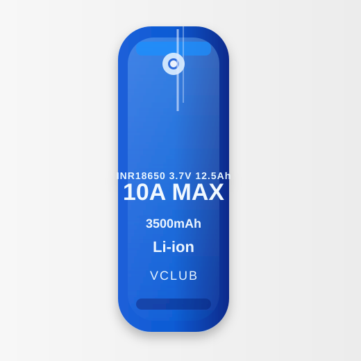

| 18650 Li-ion cells, 3500 mAh, 10 A | 3 | $6.50 | $19.50 | Proposed 3S pack cells. Use reputable cells with suitable protection and discharge ratings; confirm fit and charging compatibility with the chassis. |

Figure: 18650 Li-ion cell, 3500 mAh, 10 A
